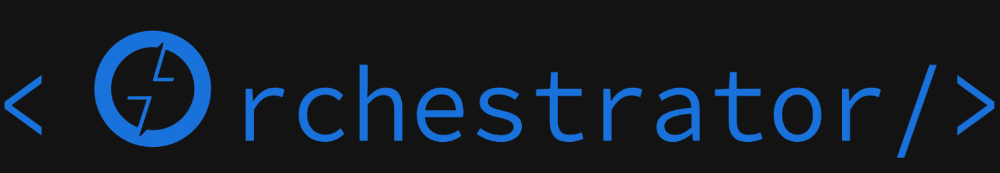
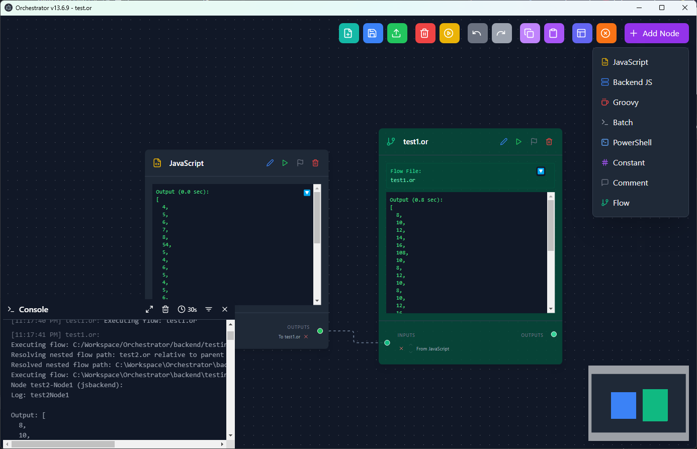

# 

Orchestrator is a web-based visual workflow orchestration platform built with React and Node.js. It lets you design, edit, execute, schedule, import, export, and monitor node-based flows across configurable backend workers.



## Features

- Visual drag-and-drop flow editor powered by ReactFlow
- Flow library at `/#/flows`
- Per-flow edit mode with autosave
- Per-flow executions view with live ANSI-colored logs
- Global executions history at `/#/executions`
- Configurable backend workers at `/#/workers`
- Worker assignment per flow
- Duplicate, delete, schedule, import, and export flows
- `.or` import/export support
- Nested flow nodes linked to per-flow session tabs
- Code editor support for JavaScript, backend JavaScript, Groovy, Batch, PowerShell, Python, and Playwright
- Real-time console output, log export, and clearable execution history
- Dark/light mode

## Getting Started

### Prerequisites

- Node.js 18+
- npm

### Install

```bash
npm install
```

### Run In Development

Start the backend:

```bash
npm run backend
```

Start the frontend in another terminal:

```bash
npm run dev
```

Open:

```text
http://localhost:5173
```

The backend runs on:

```text
http://localhost:3000
```

### Build

```bash
npm run build
```

## Main Screens

| Route | Purpose |
| --- | --- |
| `/#/flows` | Flow library |
| `/#/flows/:id?tab=edit` | Edit a flow |
| `/#/flows/:id?tab=executions&exec=:executionId` | Flow execution logs |
| `/#/executions` | Global execution history |
| `/#/workers` | Worker configuration |

The old standalone `/#/editor` route redirects to `/#/flows`; the editor is used inside flow edit mode.

## Flow Library

The flow library is the primary workspace. From `/#/flows` you can:

- Create a new flow
- Import a flow from a `.or` file
- Export a flow to `.or`
- Duplicate an existing flow
- Change the worker assigned to a flow
- Schedule a flow
- Execute a flow
- Delete a flow

Flow edit mode autosaves graph changes. There is no manual save button in embedded flow edit mode.

## Executions

Executions are visible globally and per flow.

Per-flow execution view supports:

- Selecting an execution
- Live log updates
- Automatic scroll-to-bottom on new logs
- ANSI color rendering
- Editable display name for an execution
- Exporting selected execution logs
- Killing running executions
- Clearing execution history

Backend-generated execution ids are prefixed with `YYYYMMDDHHMMSS`.

## Workers

Workers are backend servers that execute flow jobs. Each flow is assigned to one worker. A worker includes:

- Name
- URL
- API key
- Color

The flow library syncs definitions to the assigned worker before execution.

## Flow Nodes And Sessions

Flow nodes let one flow execute another flow.

You can create flow nodes from:

- Existing sessions in the current flow
- Uploaded `.or` files

When a flow node creates a session inside flow edit mode, the session is tied to that parent flow and appears in that flow's compact session tab strip.

## Node Types

| Type | Purpose |
| --- | --- |
| JavaScript | Frontend JavaScript execution |
| Backend JS | Node.js backend execution |
| Groovy | Groovy script execution |
| Batch | Windows batch execution |
| PowerShell | PowerShell execution |
| Python | Python execution |
| Playwright | Browser automation |
| Variable | Shared flow state |
| Comment | Documentation |
| Flow | Nested flow execution |
| Goto | Conditional branching |

## Project Structure

| Path | Purpose |
| --- | --- |
| `src/App.tsx` | App routing |
| `src/components/flows/` | Flow library, flow detail, executions, workers UI |
| `src/components/FlowEditor.tsx` | Embedded graph editor |
| `src/components/SessionTabs.tsx` | Session tab UI |
| `src/components/node/` | Node rendering components |
| `src/store/flowLibraryStore.ts` | Flow library and executions state |
| `src/store/sessionStore.ts` | Editor session state |
| `src/store/sessionFlowStore.ts` | Graph editor store facade |
| `src/utils/workerApi.ts` | Worker flow/execution API client |
| `src/utils/apiClient.ts` | Generic job/session API client |
| `backend/api-server.cjs` | Backend server |

## API Summary

Backend API groups:

- `/api/v1/sessions`
- `/api/v1/jobs`
- `/api/v1/flows`
- `/api/v1/executions`

Flow library endpoints use worker API keys directly. Job/session APIs use bearer sessions created through the backend.

## Development Notes

- Run `npm run build` after TypeScript or routing changes.
- Restart the backend after editing `backend/api-server.cjs`.
- Flow ids and execution ids are backend/internal identifiers; editable execution names are display labels only.
- `.or` files are JSON flow definitions containing name, namespace, description, nodes, and edges.

## Useful Links

- [React](https://react.dev/)
- [ReactFlow](https://reactflow.dev/)
- [Node.js](https://nodejs.org/)
- [Playwright](https://playwright.dev/)
- [Zustand](https://zustand-demo.pmnd.rs/)

---

© 2026 Orchestrator.
