# Orchestrator — le couple Webpanel / Worker

---

<!-- embed:toc heading="false" -->

- [Orchestrator — le couple Webpanel / Worker](#orchestrator-le-couple-webpanel-worker)
  - [1. De quoi parle-t-on ?](#1-de-quoi-parle-t-on)
  - [2. Ce que fait le Webpanel](#2-ce-que-fait-le-webpanel)
  - [3. Où le worker entre en jeu](#3-où-le-worker-entre-en-jeu)
  - [4. Vue d'ensemble en couches (ArchiMate)](#4-vue-densemble-en-couches-archimate)
  - [5. Les briques techniques](#5-les-briques-techniques)
  - [6. À l'intérieur du serveur](#6-à-lintérieur-du-serveur)
  - [7. À l'intérieur du worker](#7-à-lintérieur-du-worker)
  - [8. Les machines et la circulation des données](#8-les-machines-et-la-circulation-des-données)
  - [9. Ce que contient la base](#9-ce-que-contient-la-base)
  - [10. Le déroulé d'une exécution (BPMN)](#10-le-déroulé-dune-exécution-bpmn)
  - [11. Le cycle de vie du worker (séquence)](#11-le-cycle-de-vie-du-worker-séquence)
  - [12. Un nœud distant, appel par appel (séquence)](#12-un-nœud-distant-appel-par-appel-séquence)
  - [13. À retenir](#13-à-retenir)

<!-- embed:toc:end -->

## 1. De quoi parle-t-on ?

Orchestrator exécute des **flux d'automatisation** : des graphes de nœuds de script (JavaScript, Python, Groovy, PowerShell, Batch, Shell, Playwright) déclenchés par cron, événement fichier, appel HTTP ou à la main.

Deux applications travaillent ensemble :

- **Orchestrator Webpanel** : l'interface web (React) et le serveur central (Express). Il conçoit, versionne, planifie, orchestre et stocke tout.
- **Orchestrator Worker** : un agent distant, sans état, qui exécute les nœuds qu'on lui confie sur sa propre machine (OS, outils, réseau).

Le fil rouge de la présentation : **le serveur décide, le worker exécute, et c'est toujours le worker qui appelle le serveur.**

---

## 2. Ce que fait le Webpanel

Trois profils utilisent l'interface : le **concepteur** édite les flux, l'**opérateur** les lance et les supervise, l'**administrateur** gère comptes, secrets et workers. Derrière, le serveur central versionne chaque flux comme un dépôt git, planifie les déclenchements et orchestre le parcours du DAG.

À regarder : toutes les actions de l'interface convergent vers **« Orchestrer le DAG »**, qui s'appuie sur les secrets, les artefacts et la répartition des jobs.

<!-- embed:file="./01-architecture-fonctionnelle.gmc" view="webpanel" theme="light" -->
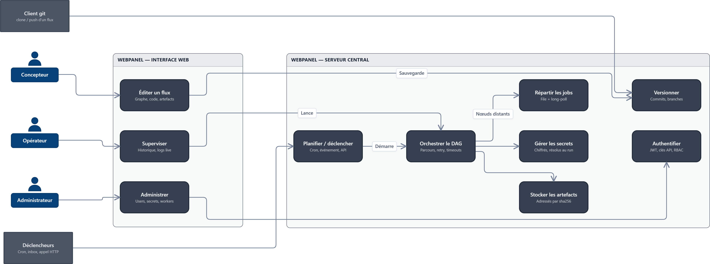
<!-- gmc-source-sha256:79e1b4e323551ea5c02bb4c4644410e602ba6cade98e43f75d8f3fd7f1822963 -->
<!-- embed:end -->

---

## 3. Où le worker entre en jeu

Quand l'exécuteur rencontre un nœud « distant » (python, groovy, powershell, batch, shell, playwright…), il ne l'exécute pas lui-même : il le **dépose en job**. Le worker vient le chercher, prépare son environnement (artefacts, secrets), l'exécute et remonte logs et résultat.

À regarder : les flèches qui traversent la frontière serveur / worker. Il n'y en a que quatre : enregistrement, jobs, préparation, résultat.

<!-- embed:file="./01-architecture-fonctionnelle.gmc" view="couplage" theme="light" -->
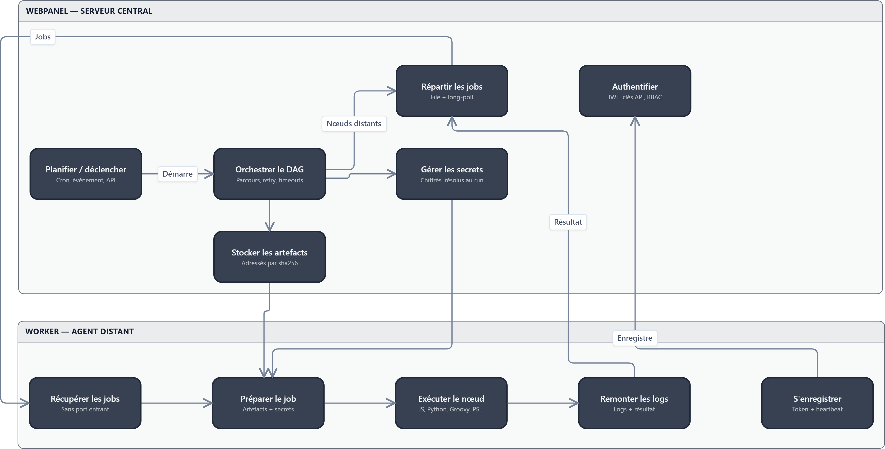
<!-- gmc-source-sha256:feadbc5a298f1ce3d82572c2e592300964a50e3f254c11f40cdb69dfb79f29f9 -->
<!-- embed:end -->

---

## 4. Vue d'ensemble en couches (ArchiMate)

La même histoire, alignée du métier jusqu'à l'infrastructure :

- **Métier** : concevoir, exécuter, superviser.
- **Applicatif** : trois services (édition & versions, exécution, logs temps réel) réalisés par l'interface, le serveur **et** le worker. Le serveur expose l'**API worker** qui sert les jobs au worker.
- **Technique** : un hôte serveur (binaire unique + base), une ou plusieurs machines worker, reliés par HTTP(S).

À regarder : le service « Exécution de flux » est réalisé conjointement par le serveur et le worker.

<!-- embed:file="./03-archimate.gmc" view="couches" theme="light" -->
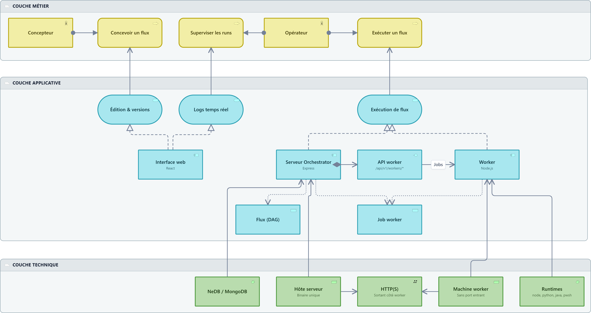
<!-- gmc-source-sha256:87642ecbd94063a979a021be6ddb23e1400e4f62ae14a6938cd659c8d83a0d81 -->
<!-- embed:end -->

---

## 5. Les briques techniques

Cinq conteneurs : la SPA React, le serveur Express, la base (NeDB ou MongoDB), l'agent worker et les processus enfants qu'il lance (un par nœud). L'utilisateur ne voit que l'interface ; le client git parle directement au serveur en smart-HTTP ; le serveur valide les tickets SSO/CAS.

<!-- embed:file="./02-architecture-technique.gmc" view="conteneurs" theme="light" -->
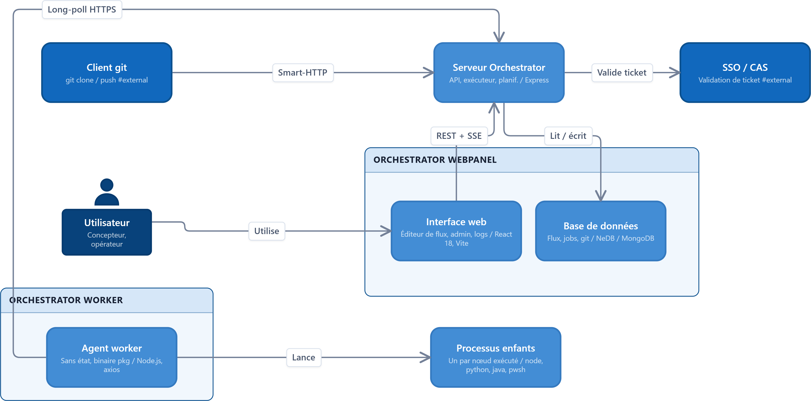
<!-- gmc-source-sha256:85570184764b13fbdf3b64f777e402ed3753aa5f8a0740347bf01c3e9e34c6c3 -->
<!-- embed:end -->

---

## 6. À l'intérieur du serveur

Une architecture en couches `http → domain → data`. Les routes restent fines ; l'**exécuteur de flux** est le cœur ; le **service workers** gère la file de jobs et réveille les long-polls en attente ; les **repositories** sont le seul accès à la base.

À regarder : l'**API worker** est une porte d'entrée distincte des routes de l'interface, avec sa propre authentification par token worker.

<!-- embed:file="./02-architecture-technique.gmc" view="composantsServeur" theme="light" -->
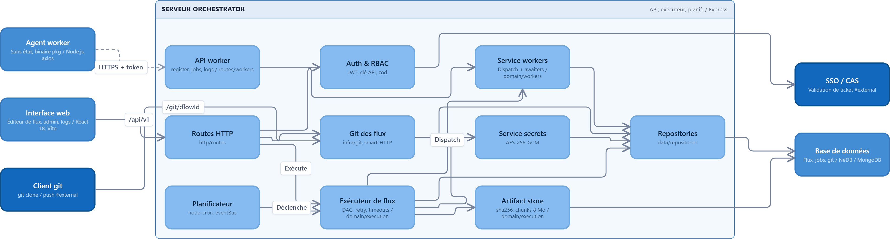
<!-- gmc-source-sha256:0ad88ee7d98e6db06916b0842602ad5d8dfddfb277509e452d806f51f64cc6ca -->
<!-- embed:end -->

---

## 7. À l'intérieur du worker

Un agent volontairement simple : **Lifecycle** (enregistrement, heartbeat), **Poller** (boucle de long-poll), **Job runner** qui enchaîne artefacts → secrets → runtime. Un runtime par langage, tous derrière la même interface. Tout passe par un unique **client HTTP** porteur du token worker.

<!-- embed:file="./02-architecture-technique.gmc" view="composantsWorker" theme="light" -->
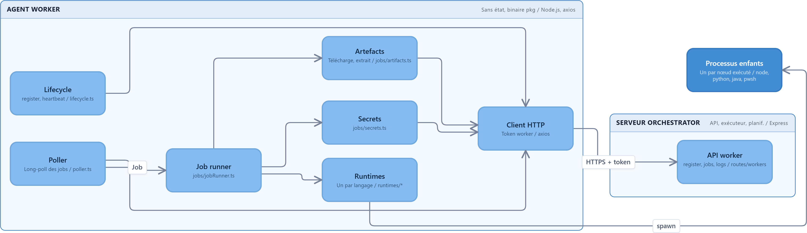
<!-- gmc-source-sha256:ab36d58ecb696ab45f55d1f35e2a9ea7082269dd09d418a681ec2cc56b7f8663 -->
<!-- embed:end -->

---

## 8. Les machines et la circulation des données

Seul le serveur touche la base. Le navigateur, le client git et les workers passent tous par lui en HTTP(S) sur le port 3939. Le stockage est soit des fichiers NeDB locaux (par défaut), soit un MongoDB dédié (`MONGO_URI`).

À regarder : la machine worker n'a **aucun port entrant**. Elle envoie ses requêtes ; les jobs, secrets et artefacts lui reviennent dans les réponses.

<!-- embed:file="./07-flux-machines-bdd.gmc" view="flux" theme="light" -->
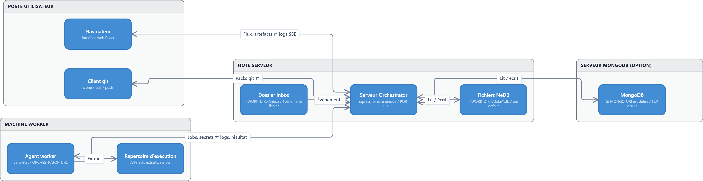
<!-- gmc-source-sha256:36dde2592aa50c06973fdd6dc9e950d5da96ad77a00c61f027e5074b26b2f487 -->
<!-- embed:end -->

---

## 9. Ce que contient la base

Seize collections, rangées par domaine : identité & accès, flux et objets git, artefacts adressés par contenu (sha256, tranches de 8 Mo), planification, exécutions, et le **couplage worker** (`workers`, `worker_jobs`).

À regarder : le worker n'écrit dans `workers` et `worker_jobs` que **via l'API worker**.

<!-- embed:file="./06-base-de-donnees.gmc" view="arbre" theme="light" -->
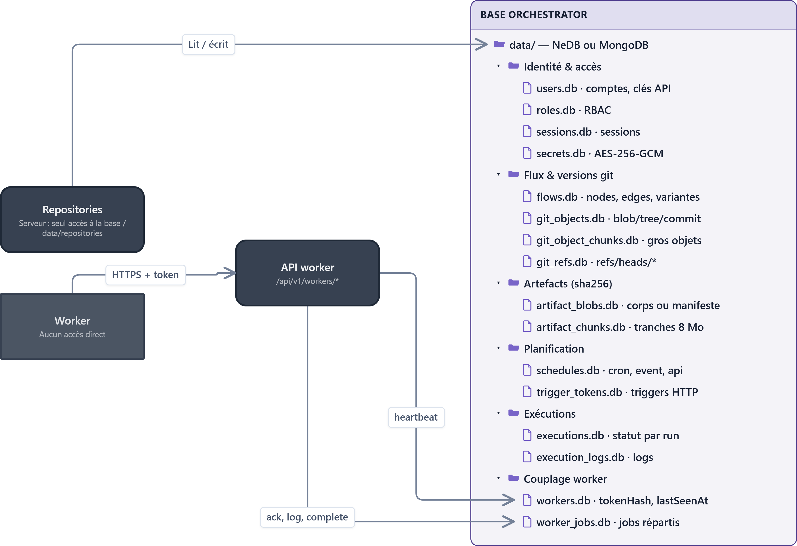
<!-- gmc-source-sha256:7799dfc44daf4035e49455bf2f57b749c221c7870dff1a234df829a9b34b3203 -->
<!-- embed:end -->

---

## 10. Le déroulé d'une exécution (BPMN)

Un déclencheur demande un run. Le serveur charge le flux puis, nœud après nœud : exécution locale, ou création d'un job pour le worker. Le worker récupère le job, prépare, exécute, remonte le résultat. Le serveur reprend alors le DAG : nœud suivant, ou fin du run (`SUCCESS` / `FAILED`).

<!-- embed:file="./04-bpmn-execution.gmc" view="execution" theme="light" -->
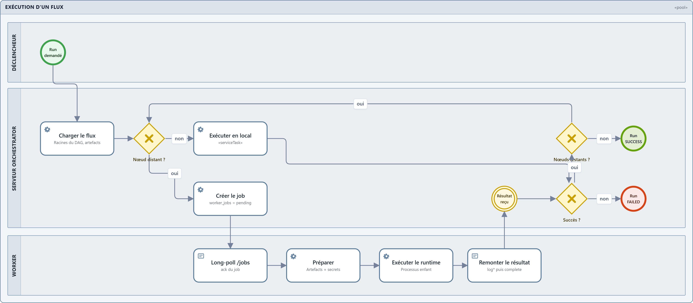
<!-- gmc-source-sha256:2f6c463f02cfe9bcb8854b145957bda31b15c603077a27f1b9a34a6e6070c989 -->
<!-- embed:end -->

---

## 11. Le cycle de vie du worker (séquence)

Au démarrage, le worker s'enregistre avec le secret partagé et reçoit un **token propre**. Il envoie ensuite des heartbeats et enchaîne les long-polls (jusqu'à ~25 s chacun). Le **reaper** du serveur annule les jobs d'un worker muet depuis plus de 60 s. Si le token devient invalide (401), le worker se ré-enregistre de lui-même.

<!-- embed:file="./05-sequence-worker.gmc" view="enregistrement" theme="light" -->
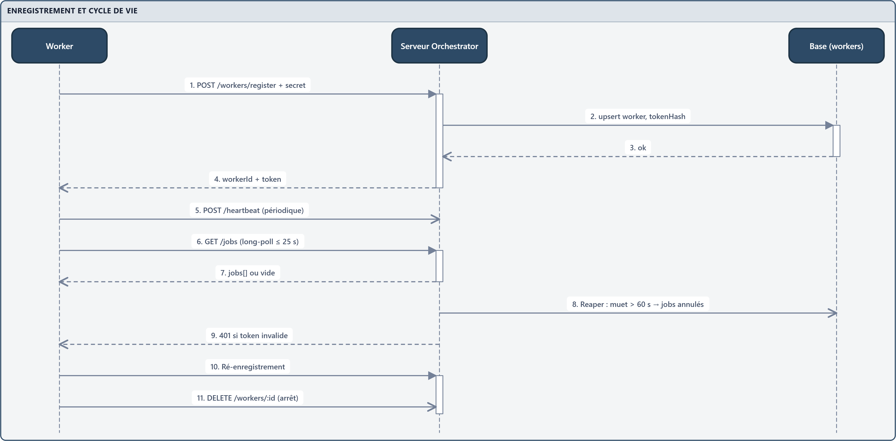
<!-- gmc-source-sha256:7f4481b219b2925d0206c5ea816b3d953e27c61e4680cac8ee7847f9363d5035 -->
<!-- embed:end -->

---

## 12. Un nœud distant, appel par appel (séquence)

Le worker attend déjà sur son long-poll quand l'opérateur lance le flux. L'insertion du job **réveille immédiatement** la requête en attente. Suivent : ack, téléchargement des artefacts, résolution des secrets, exécution dans un processus enfant, logs poussés au serveur puis rediffusés au navigateur en SSE, et enfin `complete`.

<!-- embed:file="./05-sequence-worker.gmc" view="execution" theme="light" -->
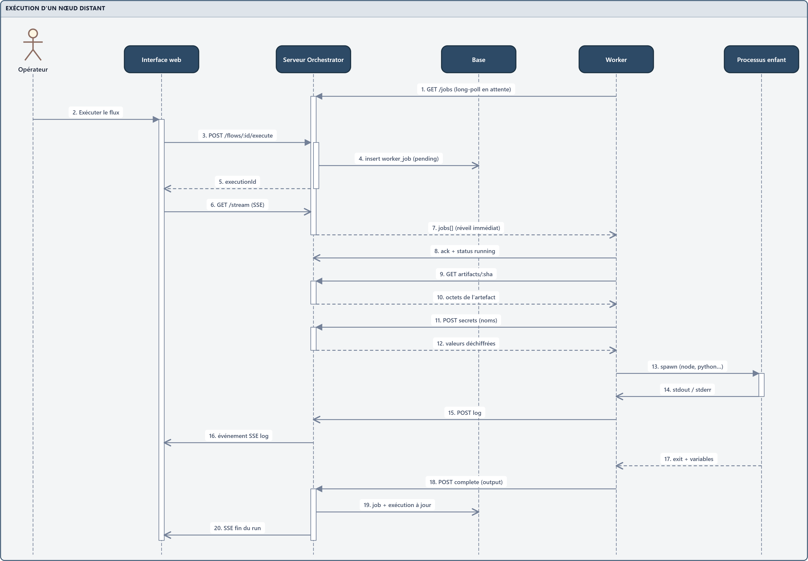
<!-- gmc-source-sha256:4ae2bb3ba510714503903e91433c9cf794b055b9b4ca3005890cac830e27f38f -->
<!-- embed:end -->

---

## 13. À retenir

- **Le worker appelle, le serveur répond** : déploiement derrière NAT ou pare-feu sans ouvrir de port.
- **Le serveur garde l'orchestration** : DAG, sous-flux, retries et timeouts restent côté serveur ; seuls les nœuds feuilles distants partent en job.
- **Le worker est sans état** : artefacts et secrets sont récupérés à chaque job, rien n'est persisté chez lui.
- **Une seule porte vers la base** : les repositories du serveur.
- **Résilience** : timeout de dispatch, reaper des workers muets, ré-enregistrement automatique, réconciliation des runs orphelins au redémarrage.
